In this guide, I will show you the first steps to setting up your active directory using windows server 2022.

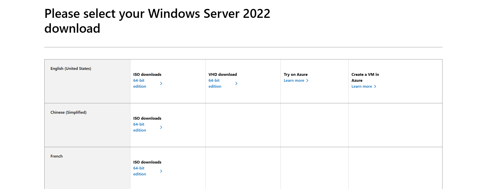

Our first step will be to download the correct windows 2022 server version for your operating system and language. I will be using the x64 architecture and English for my language. We will then open our virtual machine (if that's what you are running your server on of course). I am using Oracle VirtualBox to run my server but you can run whatever works best for your project.

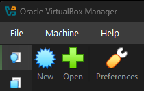

Select the option to create a new machine.

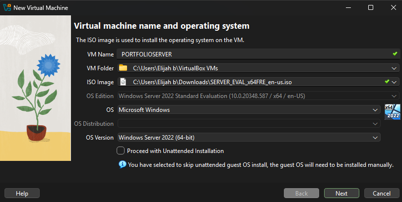

I am naming my machine 'PORTFOLIOSERVER' but you can name it whatever you would like. Under the 'vmfolder' option, select where you would like the virtual machine to sit on your actual machine. I am using my C: drive. Next you will want to select the ISO file for the server you are using. This will be the windows server file you downloaded direct from microsoft. After checking over everything again, hit next.

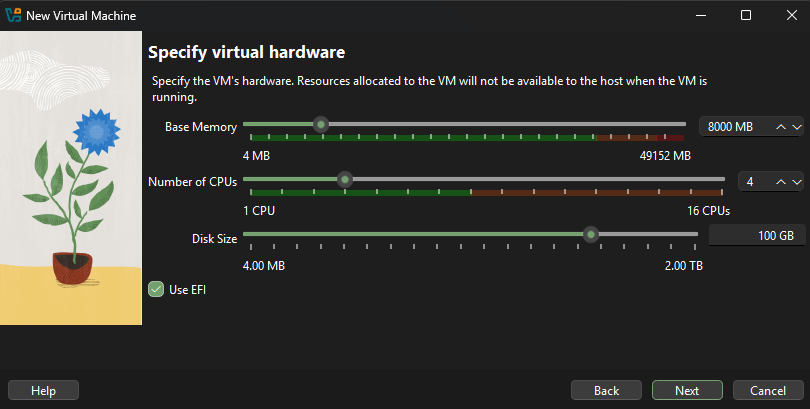

Now we will need to allocate resources from our main machine to the VM (virtual Machine) so that it can use them. I recommend at least 6,000 MB of ram and 100 GB of storage. The minimum CPU is 2 but I am using 4 as I have the resources to do so.

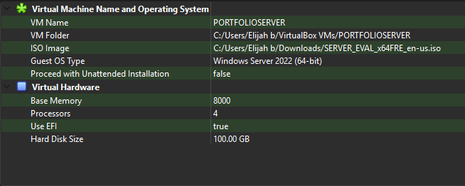

Hit continue and give everything one last glance to make sure it's to your liking.

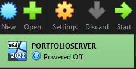

Hit continue once everything is setup the way you'd like it to be. We now have our VM!!! Move through the windows installation as normal until you get to the step with four options...

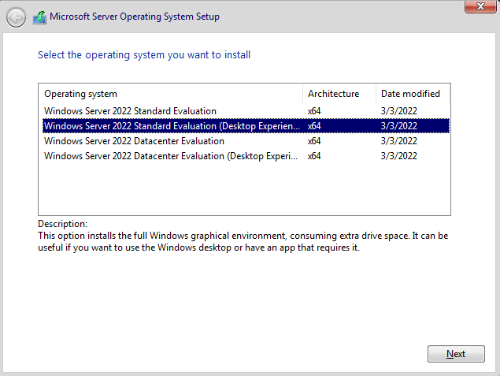

These four options represent different versions of the server that can be used. I recommend using the second option which included the desktop experience, but you can use whichever works best for you. The desktop experience also installs the windows desktop which we are all used to and can make things a bit more simple, but it does take up a bit more storage. After selecting this we can allow everything to install as it normally would.

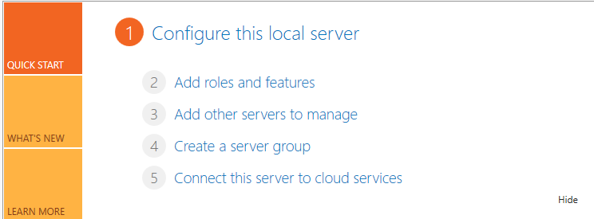

When installation is finished we will boot into our beautiful new machine! This should be the first thing you are greeted with When install finishes. We need to begin configuring our server. Select 'Configure this server'.

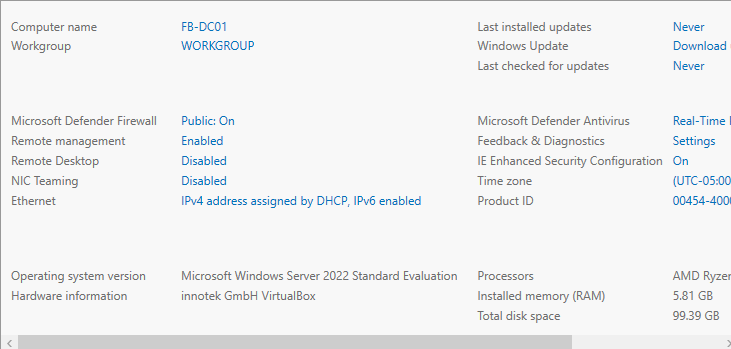

After clicking 'Configure this server' we will be greeted with a TON of settings. Right now we need only to worry about changing our computer name. I've changed mine to 'FB-DC01'. This is industry standard for naming your server. This naming for mine specifically represents the company (FB for my company which is FakeBank) the type of device (DC for Domain Controller) and the number (01 as this is the first device on the network system). Then we will follow the prompt to restart the system.

After restart we will be greeted with this page again... Select 'add roles and features' this time.

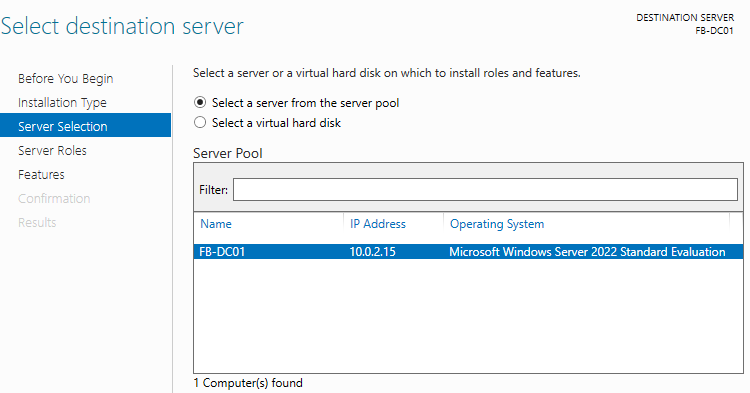

Now we will be greeted with some... 'amazing reading'. This basically just explains to you what you are about to do, but I will explain that here. Select the part that says 'server selection'. If you are following along with me you will only have the server you just set up which is perfect!

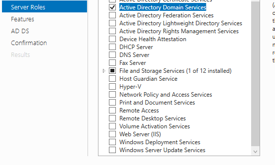

Now you will have the server roles tab. Select 'Active Directory domain services', as this is the whole reason we are doing this! Hit Next.

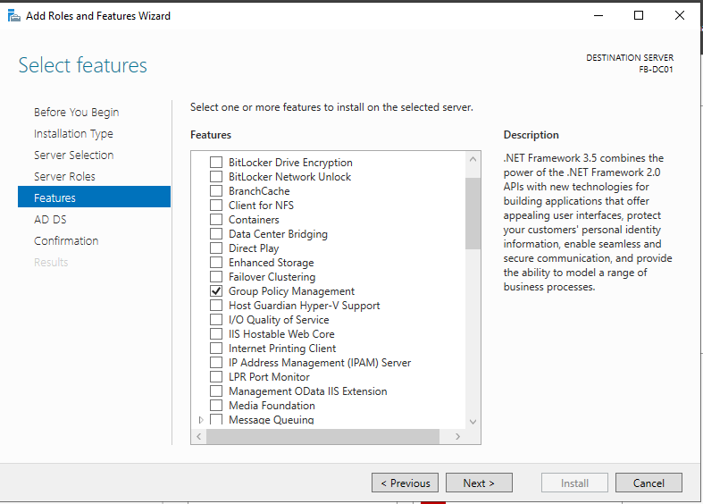

Now under features I will be leaving these to default today as we are just setting up a simple active Directory server.

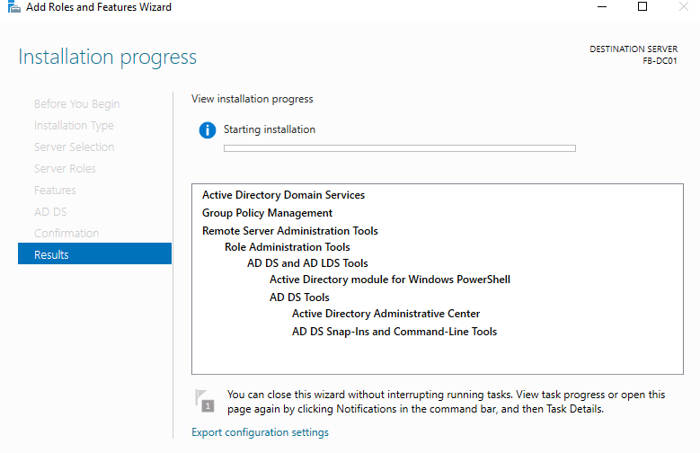

We can hit next, and then install.

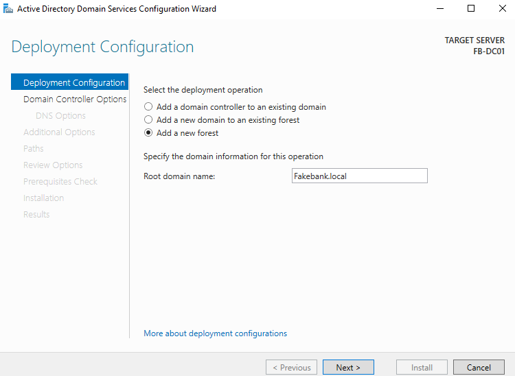

Now for the most simple part of the setup. After hitting continue you will be greeted with the page above. These are the deployment settings for our server. for this we will select 'add new forest' and then set our domain name. Mine will be FakeBank.local . Then hit next.

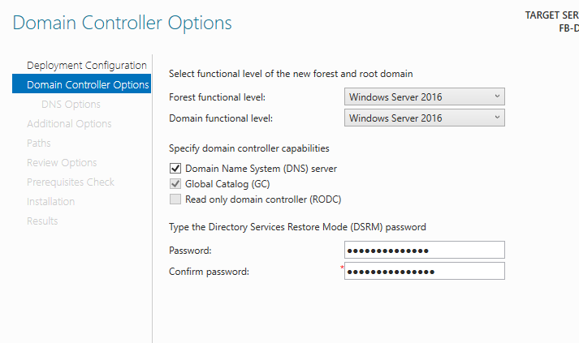

Then we will be greeted by this page. Here we setup our password for restore mode. Before that we have a few boxes. We want our server on DNS Mode and leave global catalog checked. Your Restore mode password is very important and should be very secure. If there is an issue on our server, it can be used to fix it. It is not the same as the password you used to setup your windows, so keep it safe and remember it!

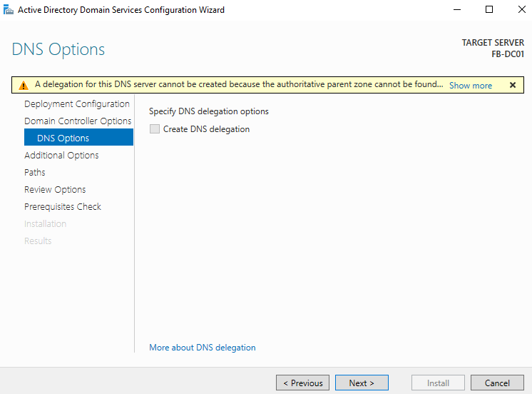

We will leave DNS delegation unchecked. This is useful if you have multiple servers, but this is our first one!

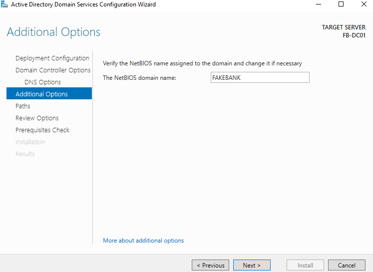

Then we will set our NETBIOS name. I've set mine to FAKEBANK. This is mainly a legacy feature, but it will give us two ways to identify our server. We will have both FakeBank.local and FAKEBANK.

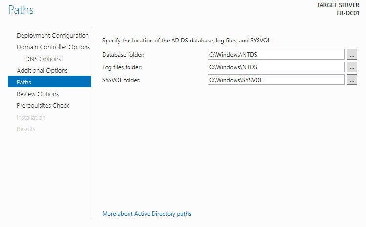

These paths will be where your server files are stored. I have left mine to default. After this setting, We will hit continue. This will restart our system and begin using our system as our windows server we have setup! In the next step, I will show you how to build your active directory environment.
