In this guide, I will show you how to add employees and groups to your Active directory server. We will start by loading into our dashboard. A blue box indicates a right click, red is a left, and green indicates you should hover. We will start by clicking the tools menu at the top right.

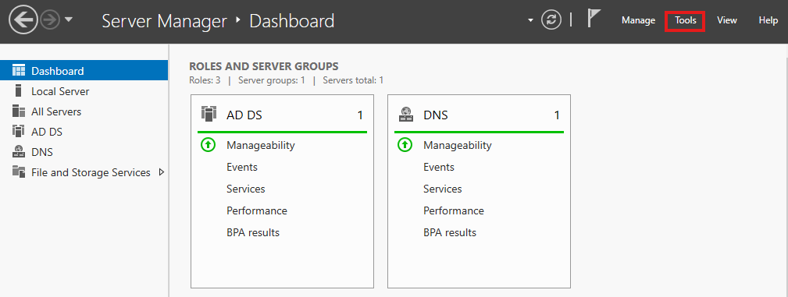

After clicking tools, navigate to 'Active Directory Users and Computers'.

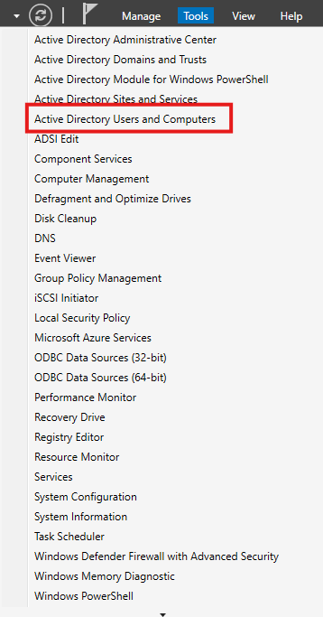

find your server, right click it and create a new OU. (organizational unit).

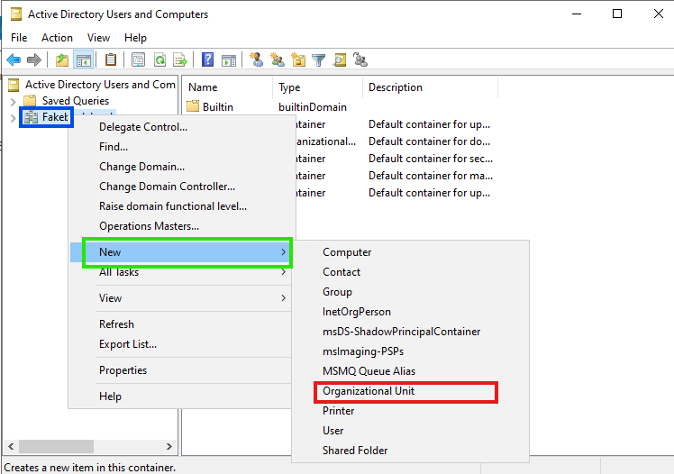

Create an employees folder. Mine will be FakeBank Employees.

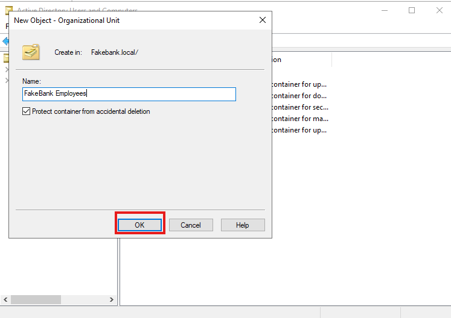

Now navigate to the OU you created and create another OU. These will be employee types.

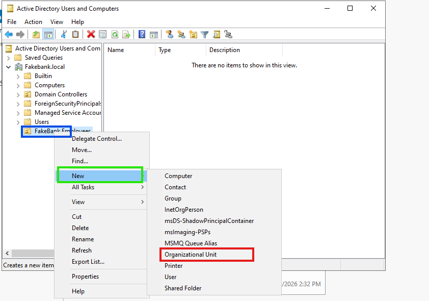

Create your employee types. I have IT, HR, Management, and our regular employees/ customer service agents.

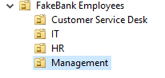

We will click our server again and make another OU. OU or organizational units are similar to branches of a folder. This one will hold our groups.

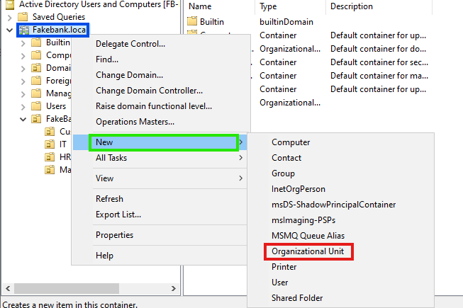

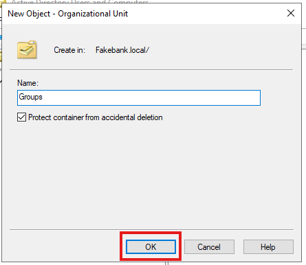

Now right click the groups folder, select new, and create a new group.

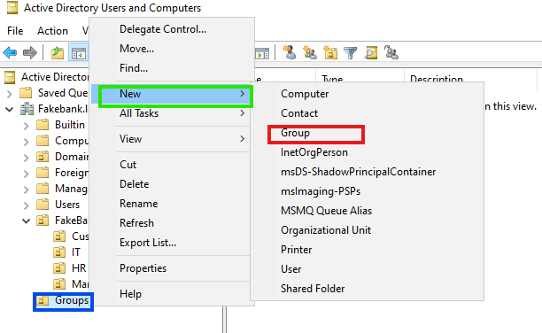

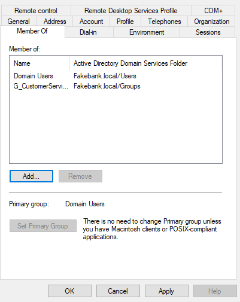

I have created groups for each employee type.

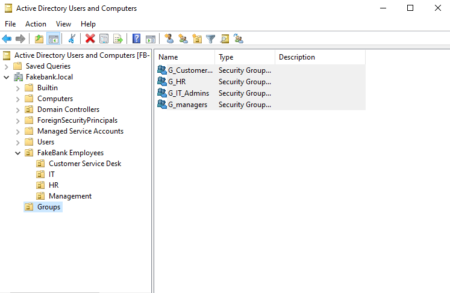

Now all we have to do is place our new customer service worker, Sarah M. Smith, into her correct folder and group! Let's add her by creating new, then user.

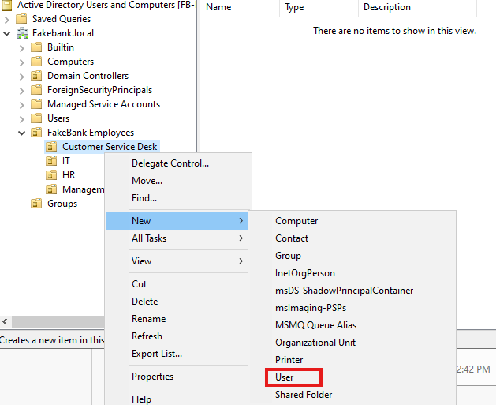

We will fill in Sarah's info into the boxes and hit next to continue.

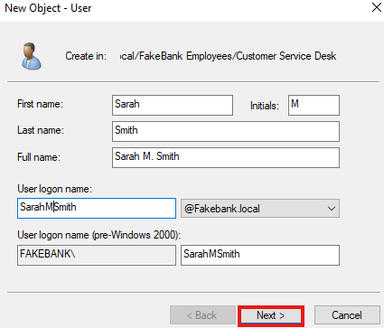

Then we will create her password. This password is a one time use password due to me checking the box that says she has to change it at time of login. This gives her easy access to the system and allows her to set a more secure password.

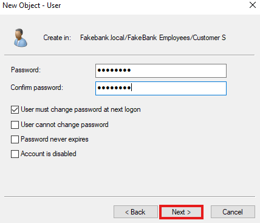

Now we will hit next, where we will see Sarah's login name.

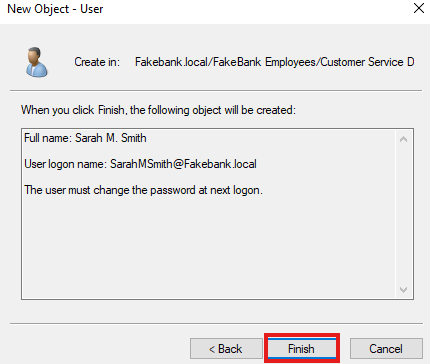

Now we will give Sarah her group! Groups decide what employees are actually able to do on their systems! Do we want Sarah having access to records she shouldn't Or being able to see other employees sensitive information??? To prevent this we will place her in the G_CustomerService group.

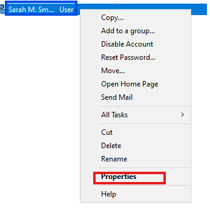

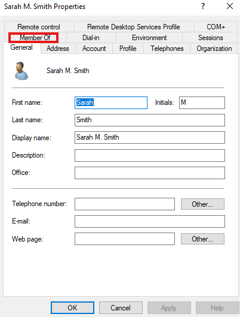

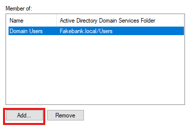

Now where it says 'Enter the object names to select' we enter Sarah's Group name.

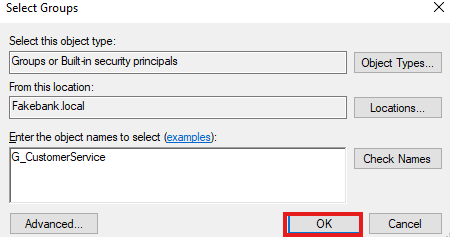

Now we just hit apply and Sarah is in her correct place and will have the permissions she needs to complete her work!
