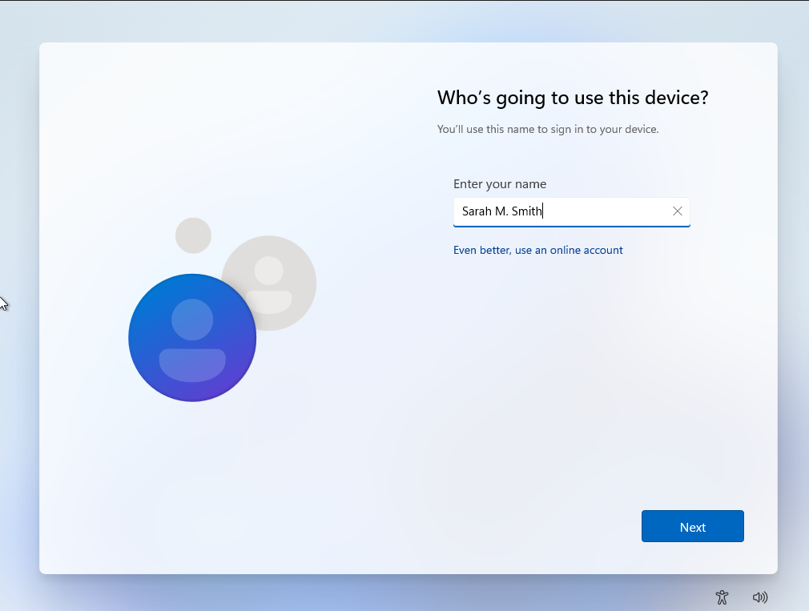
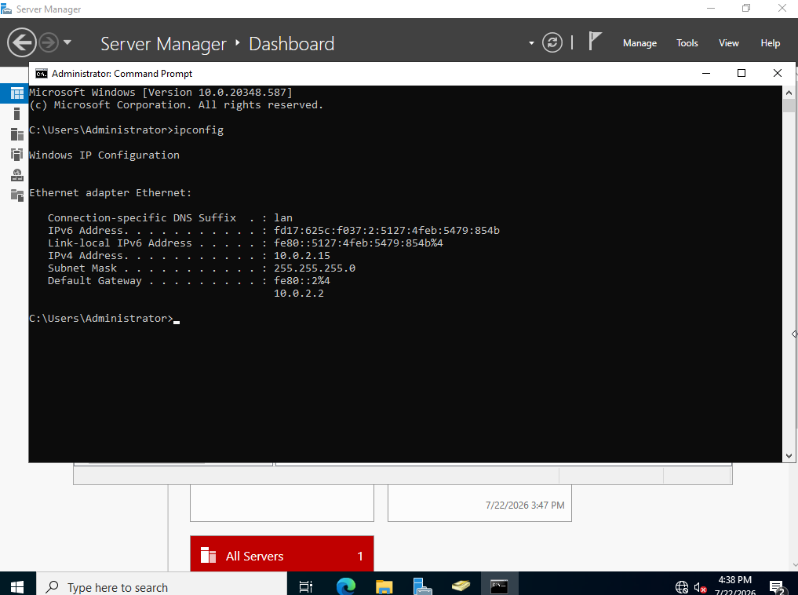
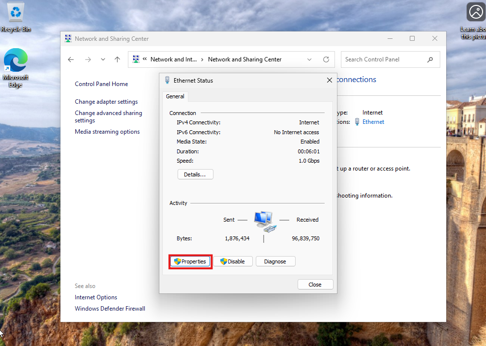
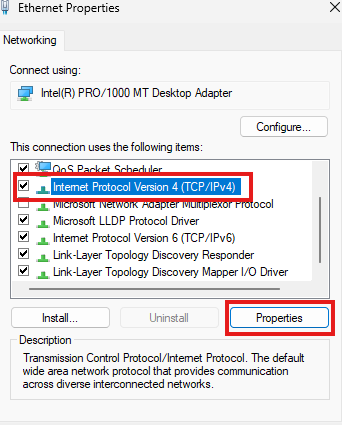
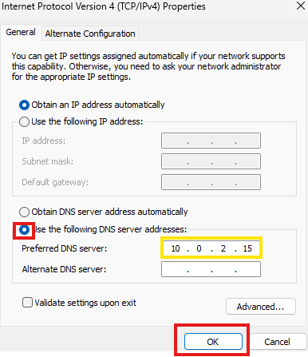
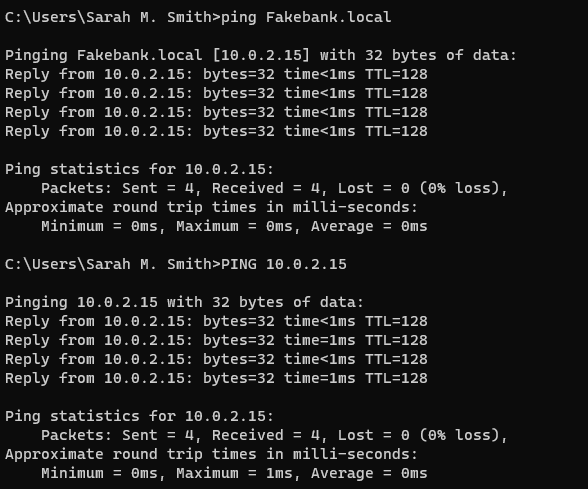
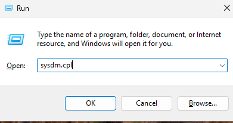
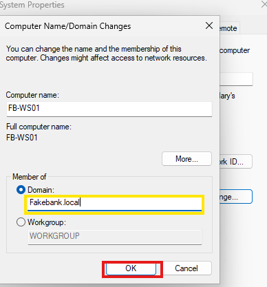
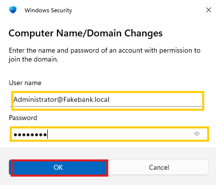
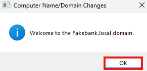

In this guide, I will show you how to add your employees device to the domain we created.

Now we are setting up Sarah's PC. Create an admin account named whatever you'd like on the OS.

And now we will go back to our server. Open the cmd prompt and type ipconfig to find the IP of our server.

Open the control panel and navigate to the Network settings page. open our connection type and click properties.

Click the IPv4 settings and hit properties.

Click to use a custom DNS address and enter the IP of our server.

Now try to ping our server, both by IP and the Local address. If both come back we are successfully connected!!

Now hit the Windows key and R at the same time to open the RUN command box. Enter Sysdm.cpl to open the domain changes.

Click Domain and change it to our servers domain.

Enter the domain account info.

We will now see a message telling us we are successfully connected!! You can now move to Step Four: Managing Users and Computers with Group Policy
