In this guide, I will show you how to manage Users and computers using group policy.

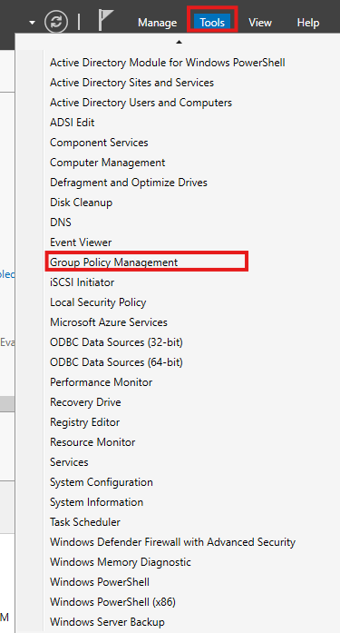

First we will open our AD server. Select 'tools' and click 'group policy management'.

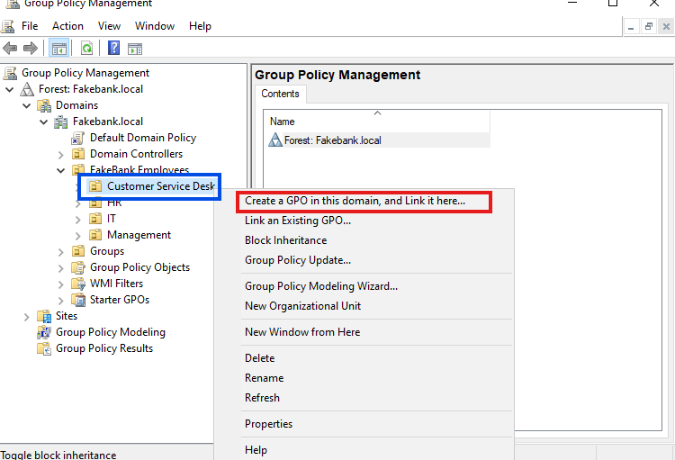

In the Group policy management go to the correct group. For Sarah this is the Customer service group. Right click on it and select to create a GPO in the domain.

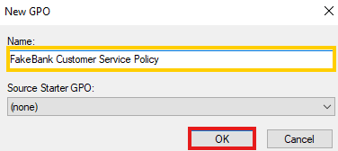

Name your GPO. We will name ours 'FakeBank customer service policy'.

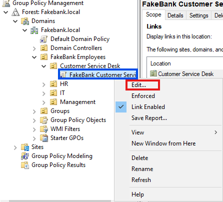

Now right-click the new GPO and select edit.

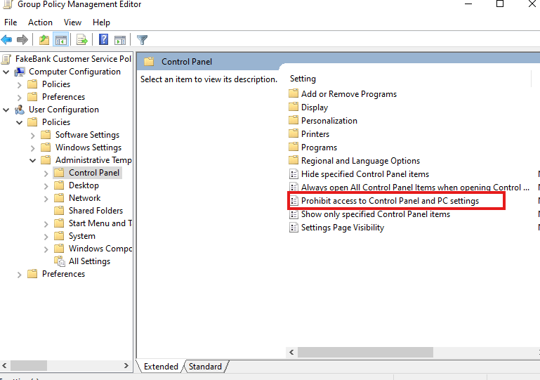

In this example we will make it to where our customer service agents cannot use control panel. Select the 'Prohibit access to control panel and pc settings' option.

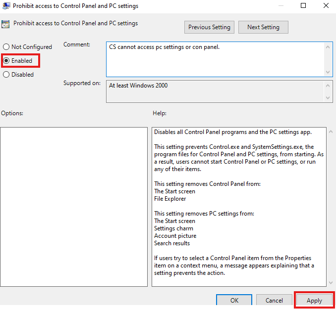

Enable this, optionally explain with a comment, and then hit apply.

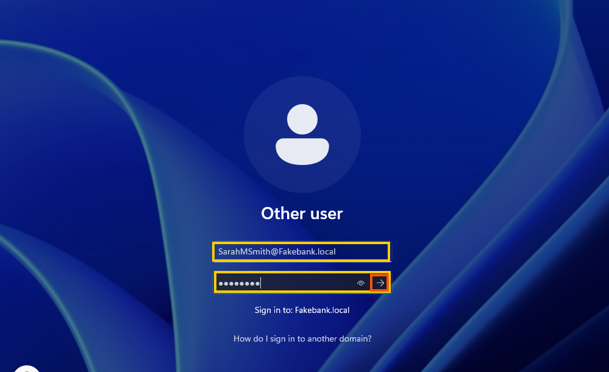

Now we will load into Sarah's computer and test the feature. First let's check if her @fakebank.local account is working!

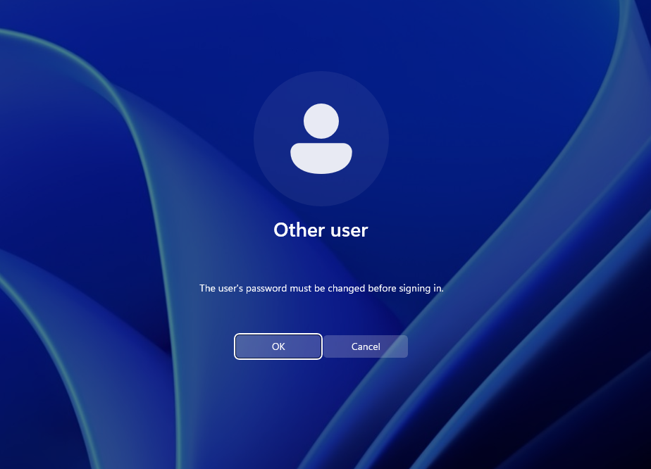

We know that everything we are setting up is working so far because Sarah is asked to change her password!!

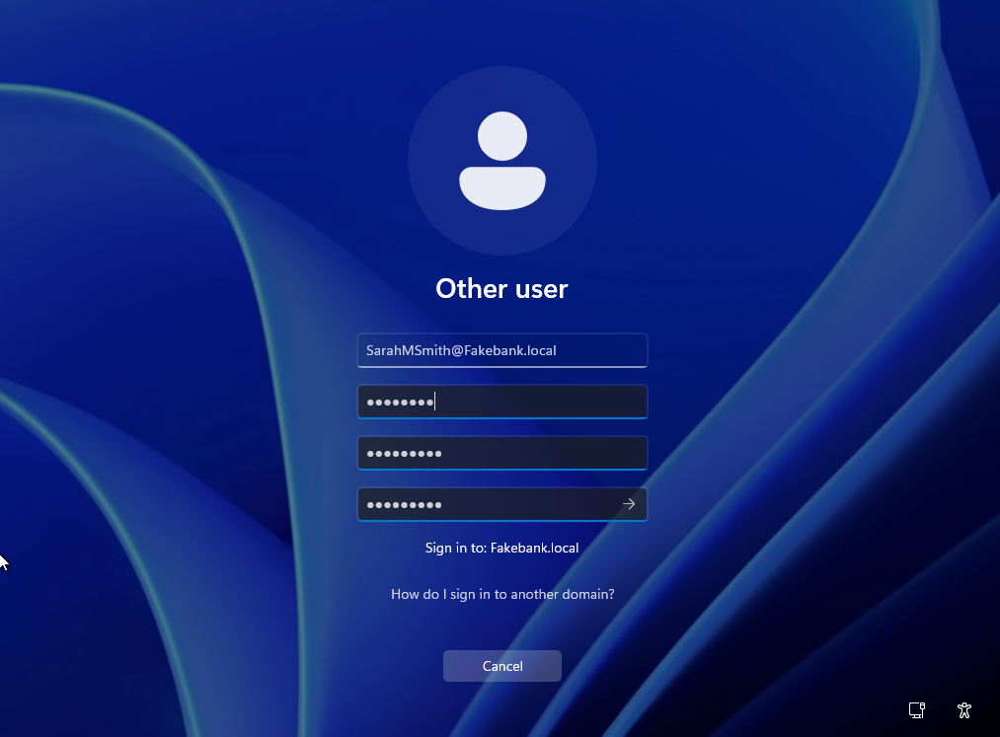

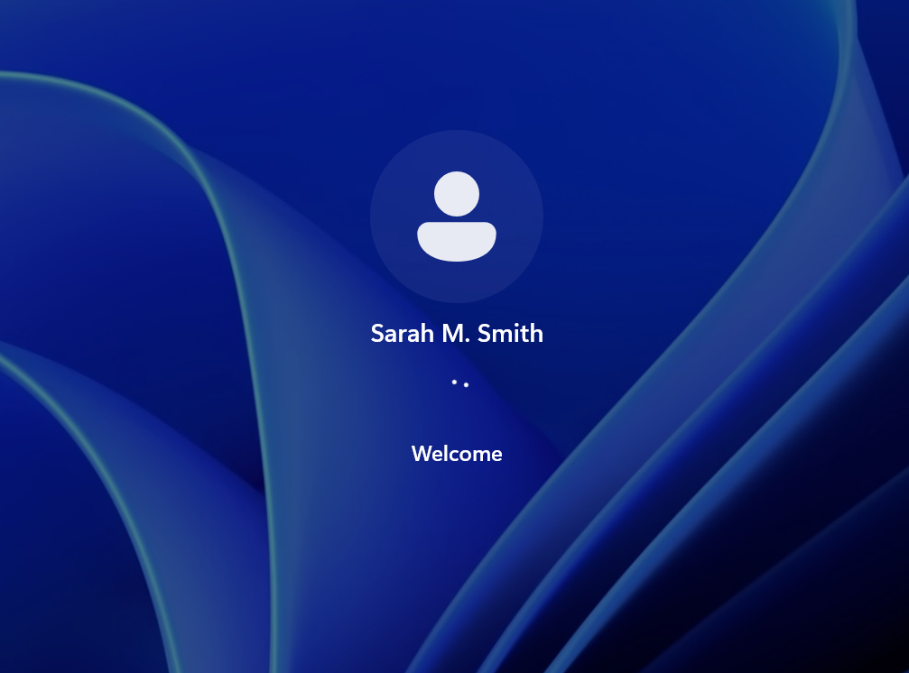

Sarah enters her new desired password and hits enter.

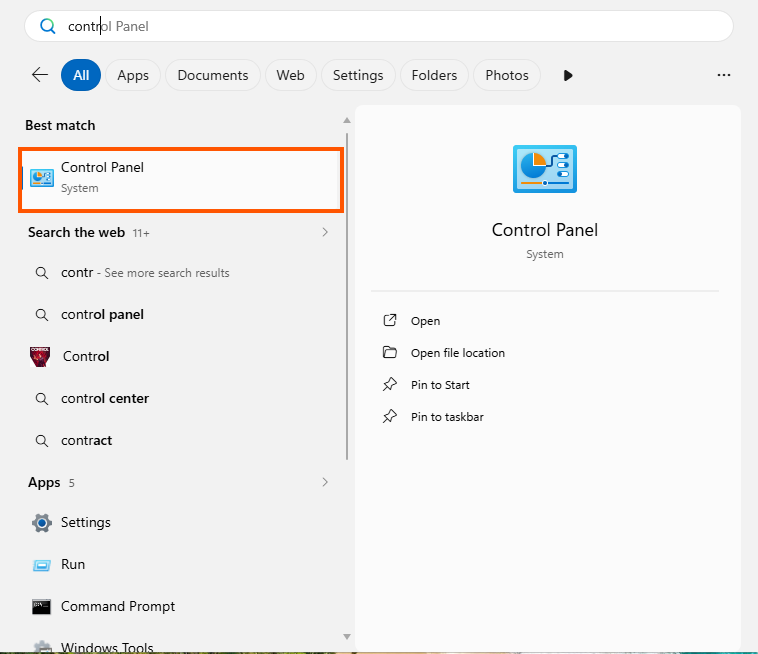

Now we attempt to open control panel to make sure the group policy is working. An error here is actually a good thing!

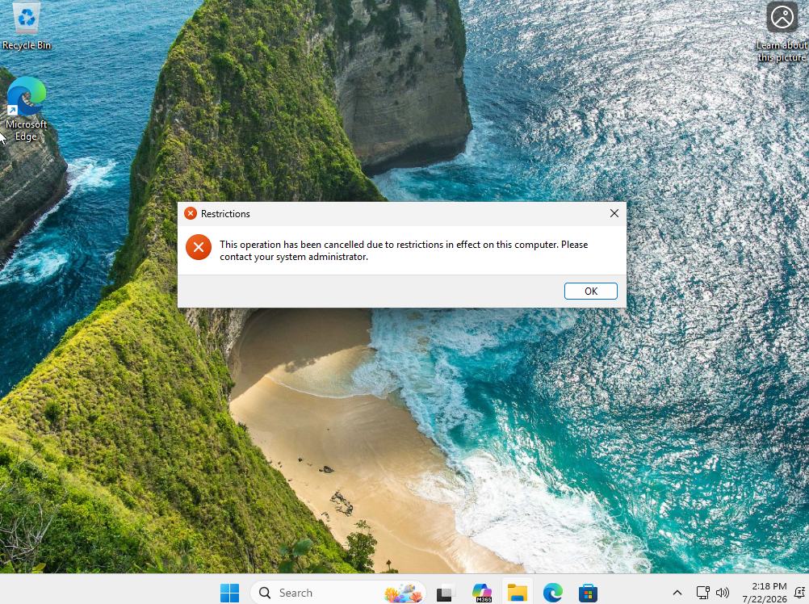

Perfect! We see that she does not have access to control panel or PC settings. Now we will move to step Five and learn to make shared folders, setup NTFS permissions, and setup network drives.
