In this guide, I will show you how to set up a shared folder / shortcut / GPO deployment. First we create a folder on our server that includes call scripts for employees.

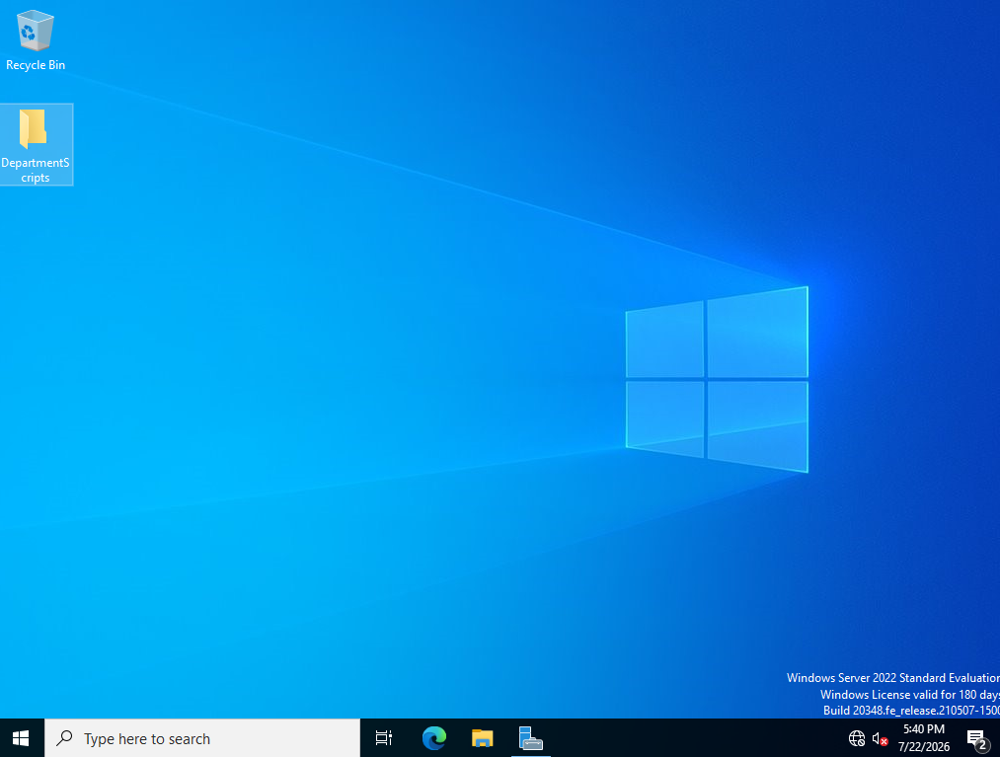

I have created scripts for each employee type.

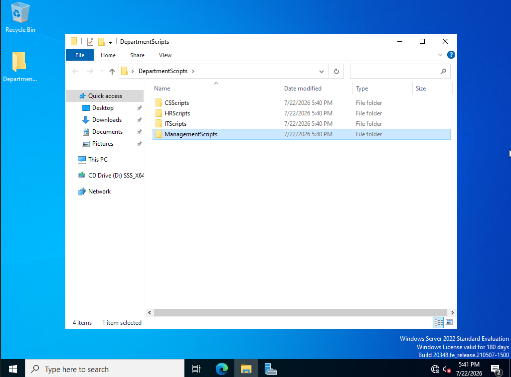

Now, for Sarah, I will place the call scripts she needs.

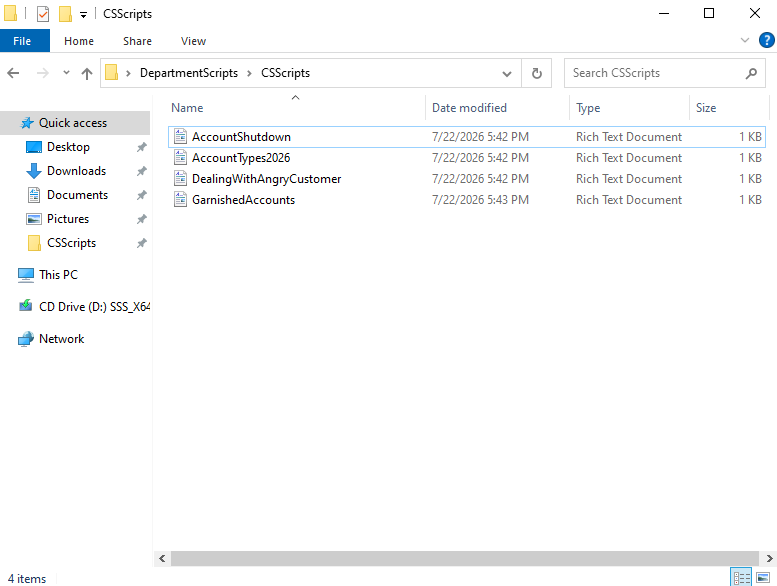

Now we will go to the folder for the customer service call scripts and click properties.

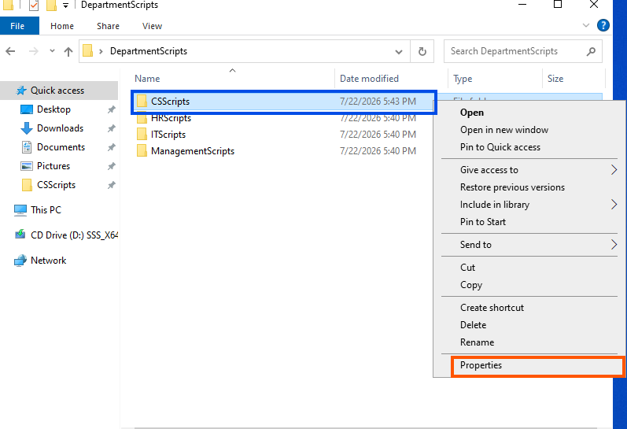

Under properties click share then advanced sharing.

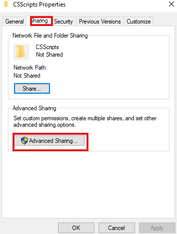

Under share create the shared name and apply.

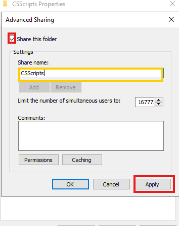

Then go back to share properties and hit sharing.

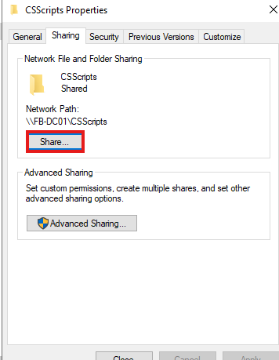

Add the customer service group we created earlier. We will set the permissions to read only.

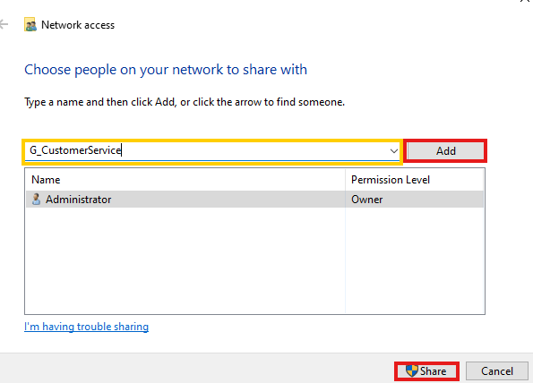

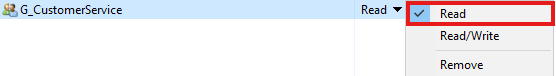

We then see a message confirming the file share.

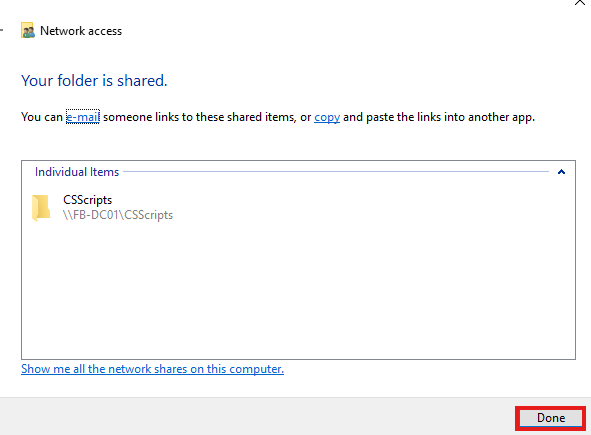

Now in our server we will go to tools and select group policy.

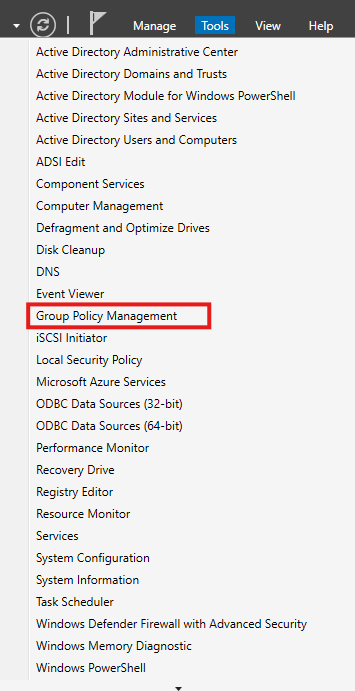

Select our customer service GP and hit edit. What we are doing now is forcing a shortcut onto the customer service agents desktop.

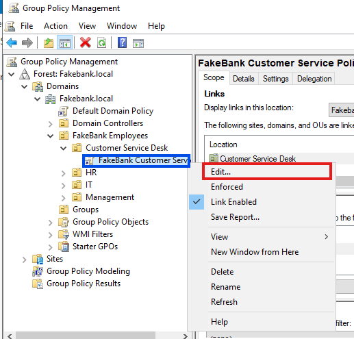

Navigate to this path to create the shortcut.

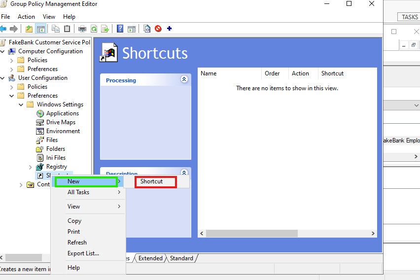

input the file location that we shared.

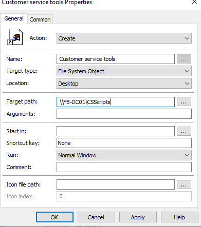

Now we load into Sarah's desktop. We can see that the file is placed on her desktop as a shortcut.

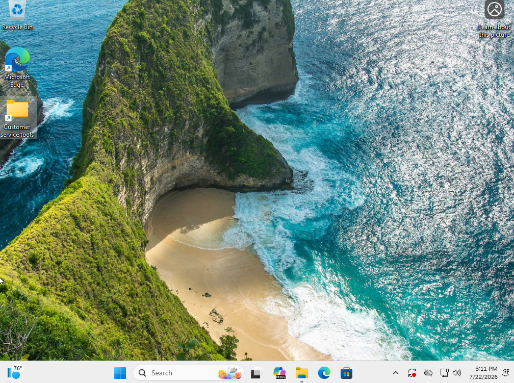

and if we click the file we can see that the files are successfully on her desktop for her to use!

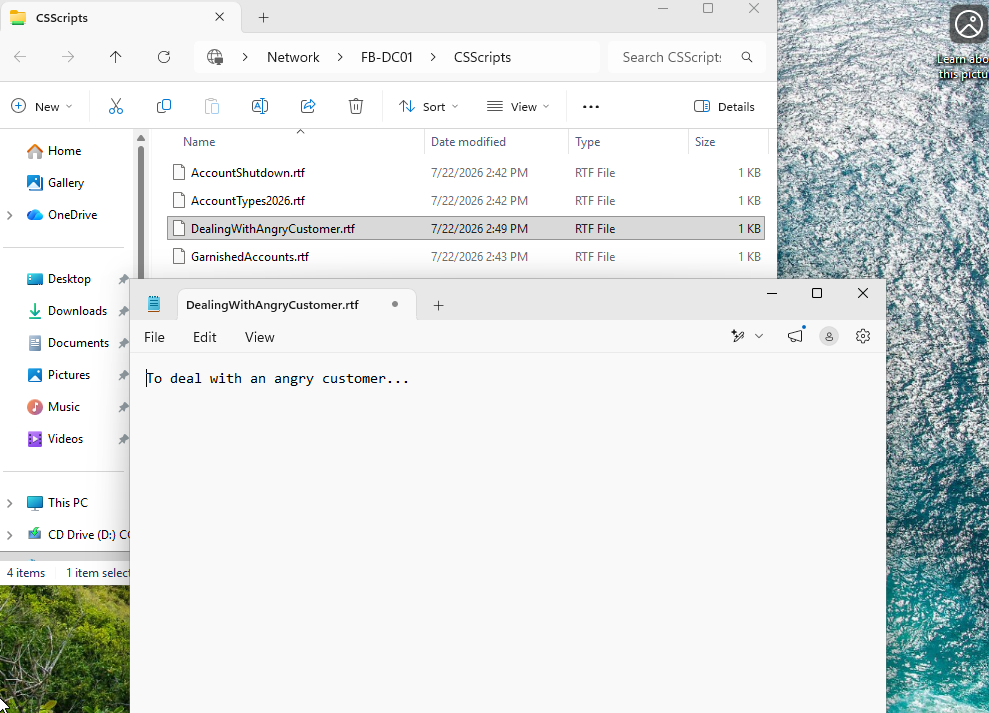

Next we will be learning to create password Policies and setup account security features!
