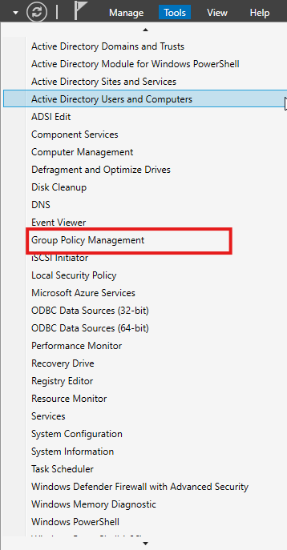
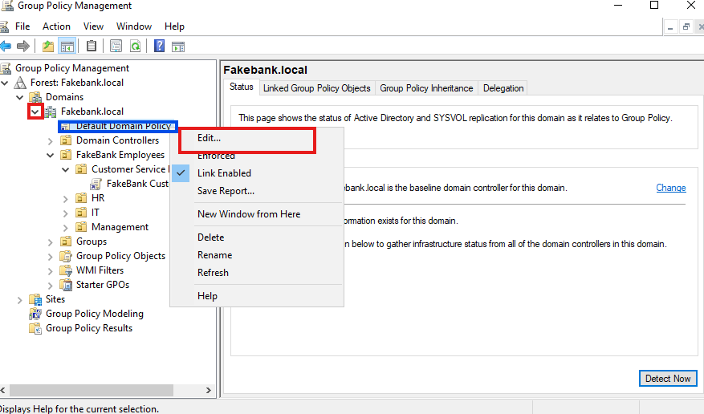
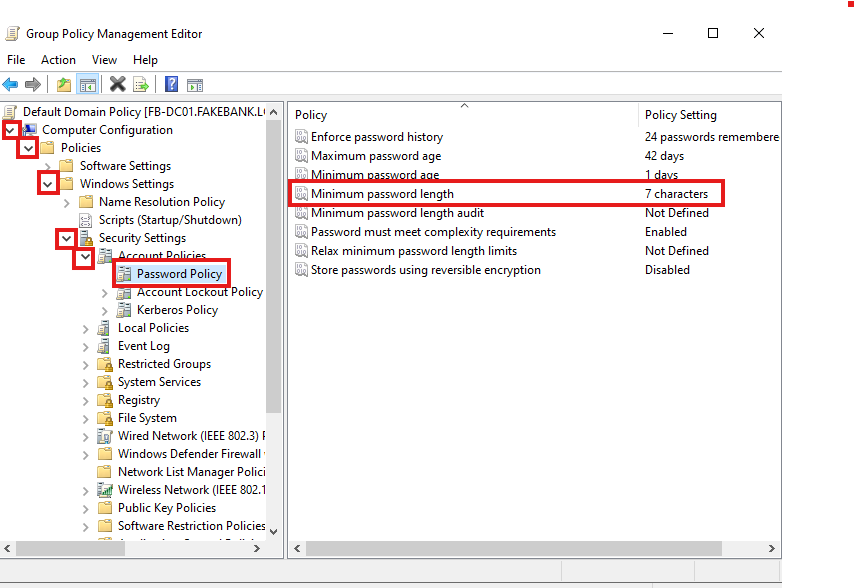
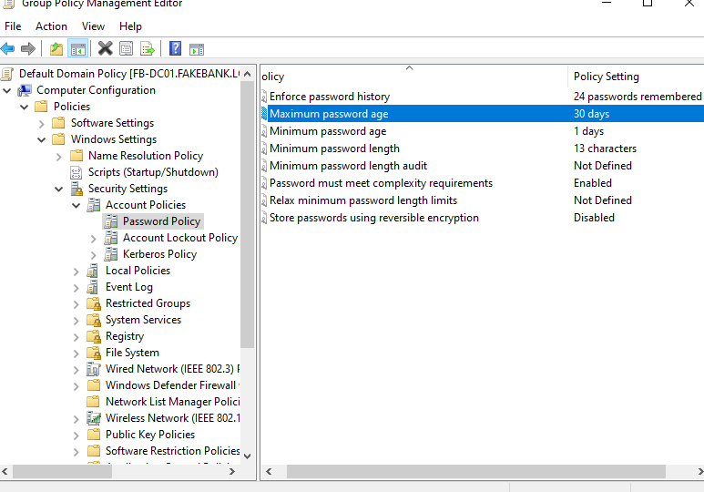
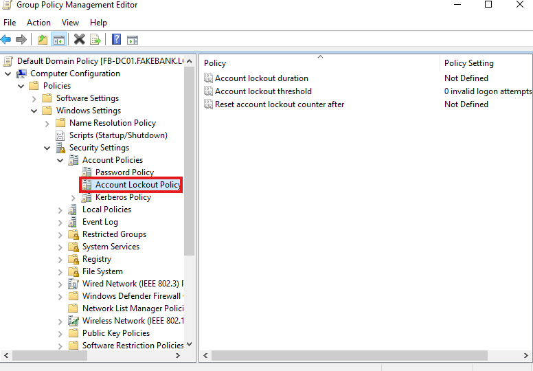
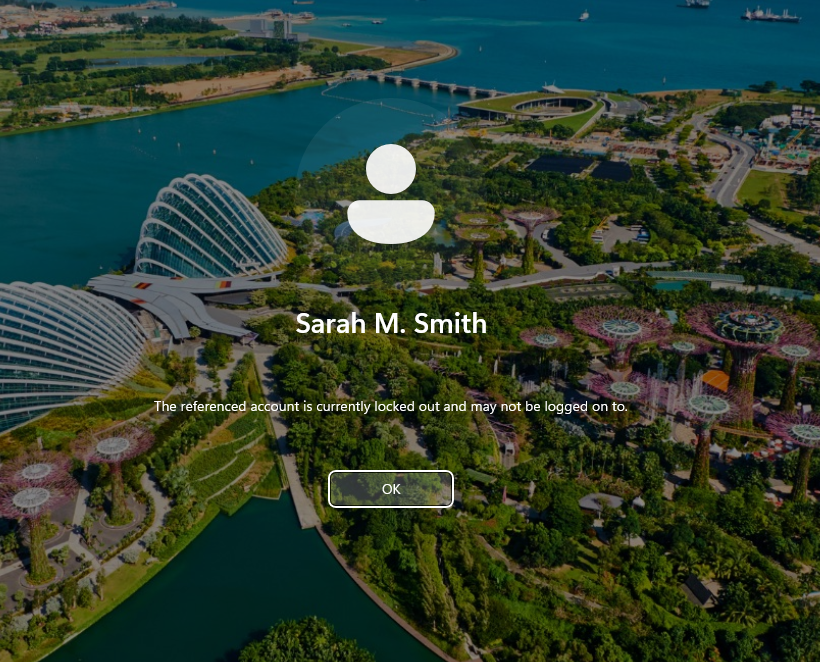
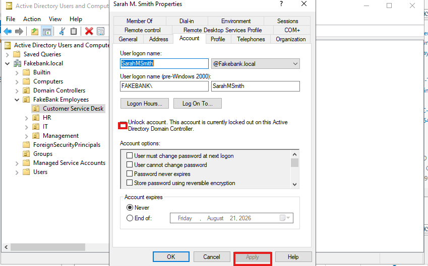

In this guide, I will show you how to set up password policies and unlock a locked account. We begin by opening the Group policy manager on our server.

Right click our default domain policy and select edit.

Follow the dropdowns and select the password security settings.

Here we will be editing the password settings. As an example I set the minimum password length to 7, but I recommend at least 12 characters

Now let's edit the account lockout policy. This is how many attempts with a wrong password before the account is locked. I've set it to 3 for my example.

Now we open Sarah's PC. Entering an incorrect password multiple times will give us this prompt.

Awesome! So it clearly is working. Now let's unlock her account. Head over to Sarah's account and click the unlock account button. Sarah's account is now unlocked.

